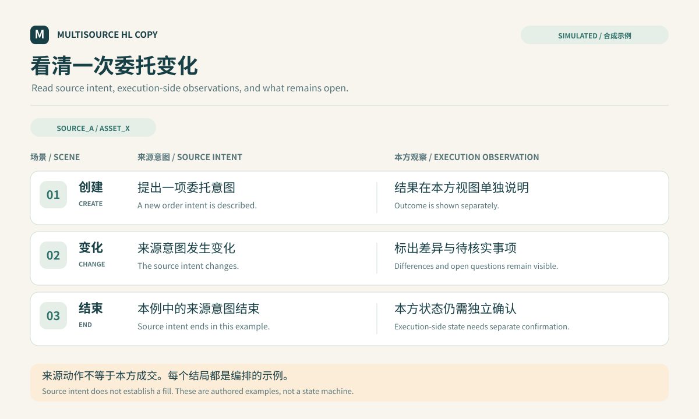

# Multisource HL Copy

**Multi-source trading execution for Hyperliquid · Public showcase**

A clear view of source intent, execution outcomes, and the risks that need attention.

[中文](README.md) · [Capabilities](docs/en/features.md) · [Scenarios](docs/en/showcase.md) · [Overview](docs/en/architecture.md) · [Evidence & limits](docs/en/testing.md) · [FAQ](docs/en/faq.md)


> This repository presents the project's capability scope, product ideas, and synthetic scenarios. The production trading implementation remains private. This package cannot connect an account or trade. Every illustration and data example is independently constructed for explanation, not taken from a live run.

## What the project focuses on

When one execution account follows several sources, an operator needs to understand which source changes are visible, what happened on the execution side, what is still uncertain, and what needs attention.

Multisource HL Copy organizes execution, operational control, and reporting around those questions. Public materials explain the product experience while keeping execution algorithms, decision rules, and deployment details private.

## Capability map

These are capability themes, not claims that this public package verifies a live trading system.

| Theme | The operator's question | Public presentation |
| --- | --- | --- |
| Multiple sources | How can activity and state be understood separately? | Anonymous source cards and parallel scenarios |
| Order following | How do source intentions relate to execution outcomes? | Conceptual creation, change, and end examples |
| Position changes | Which changes or unresolved facts need attention? | Qualitative descriptions without sizing rules |
| Operational control | What is running, what is in scope, and what was observed? | Responsibility and interaction descriptions |
| Risk visibility | Which facts are confirmed, and which remain unknown? | Illustrative notices and review items |
| Periodic reporting | What changed, and what should be reviewed next? | A synthetic report with a field guide |

See [Capabilities](docs/en/features.md). Scenario endings are authored examples. They do not imply that a source order must be followed, filled, or filled at the same price.

## A three-minute tour

1. Read [Scenarios](docs/en/showcase.md) for order changes, multiple sources, risk notices, and reports.
2. Read [Overview](docs/en/architecture.md) for responsibilities and product trade-offs.
3. Read [Evidence & limits](docs/en/testing.md) to distinguish descriptions, illustrations, and verification.
4. Read [Public scope](docs/en/public-scope.md) for this edition's disclosure boundaries.



## What works locally

Read the Markdown, open the SVGs, or inspect the [synthetic examples](examples/README.md). To validate and package the showcase, use Python 3.10 or newer:

```bash
python3 tools/check_public.py
python3 tools/package_public.py --output ../Multisource_HL_Copy-public.zip
```

These utilities operate on local showcase files only. They contain no trading SDK, account configuration, key input, network query, or order submission. The GitHub workflow also validates only public content.

## Reading guide

| Page | Contents |
| --- | --- |
| [Capabilities](docs/en/features.md) | Product scope, scenarios, and limitations |
| [Scenarios](docs/en/showcase.md) | Four independently constructed reading journeys |
| [Overview](docs/en/architecture.md) | High-level responsibilities and observable outcomes |
| [Evidence & limits](docs/en/testing.md) | What this package can and cannot establish |
| [FAQ](docs/en/faq.md) | Running, examples, reuse, and feedback |
| [Roadmap](docs/en/roadmap.md) | Improvements to public presentation materials |
| [Maintaining this showcase](docs/maintaining-public.md) | Validation, packaging, and history boundaries; bilingual |
| [Public scope](docs/en/public-scope.md) | Disclosure boundaries and licensing |
| [Releases](RELEASES.md) | Public-material changes only |

## Feedback and rights

Suggestions about wording, diagrams, translation, and product communication are welcome. Follow [Contributing](CONTRIBUTING.md) and avoid account or deployment details. Read [Security](SECURITY.md) before reporting sensitive material.

Rights are reserved in new original material in this edition; earlier permissions remain applicable to the corresponding material. See [LICENSE](LICENSE) and the [legacy notice](LICENSES/LEGACY_LICENSE.txt). This showcase does not open-source the production implementation or promise returns. Hyperliquid identifies the platform the project concerns; it does not imply affiliation or endorsement.
