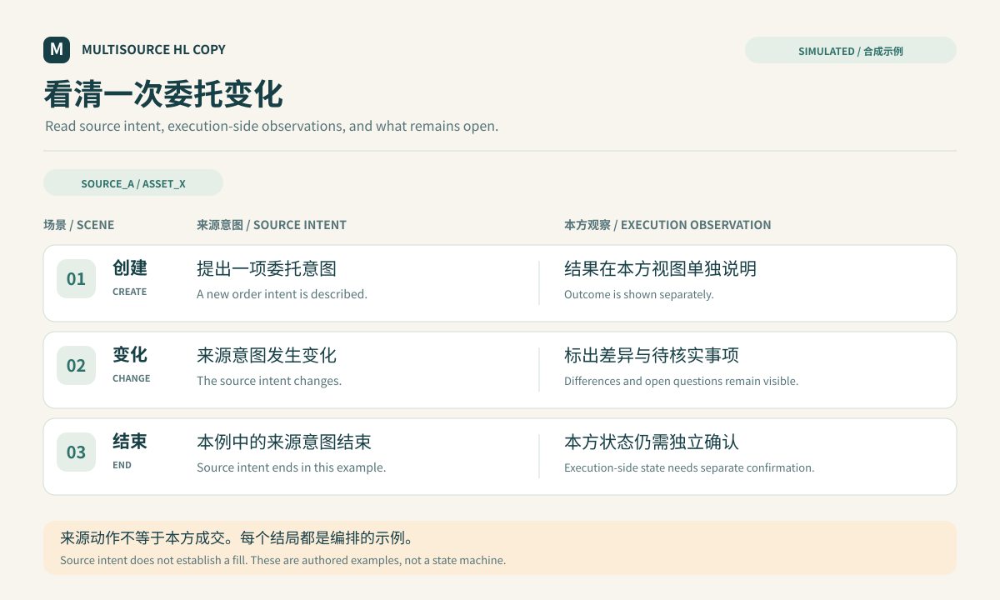

# Multisource HL Copy

**Multi-source trading execution engine for Hyperliquid**

Event-driven · Rust execution core · Fault-tolerant · Risk-aware

[English](README.en.md) · [架构](docs/overview.md) · [功能](docs/features.md) · [效果](docs/showcase.md) · [测试与统计口径](docs/testing.md) · [路线图](docs/roadmap.md) · [版本记录](RELEASES.md)

---

一个执行账户同时跟随多个 Hyperliquid 来源钱包的永续合约委托：按比例镜像挂单、跟随减仓与吃单开仓，并在异常时暂停、撤单或平仓。跟单是它的应用场景；项目的重点是背后的执行系统——多来源事件如何归属、订单生命周期如何闭环、异常时如何不重复、不猜测、能停下来。

> 这是项目的**展示仓库**：介绍系统做什么、怎么分层、验证到了哪一步。生产实现保存在私有仓库，这里没有可运行的交易程序，也不提供演示程序。范围说明见 [PUBLIC_SCOPE.md](PUBLIC_SCOPE.md)。

## 解决什么问题

手动或简单脚本跟单，在多个来源、高频挂撤单、断线和部分成交面前很容易出错：同一张单下两次、来源撤了本方没撤、几个来源在同一个币上互相抵消、断线后按过期数据下单。这个项目把这些情况当作一等问题处理，目标是**跟得上、撤得掉、对得上账，出问题时先停下来**。

## 系统分层

| 层 | 职责 | 实现 |
|---|---|---|
| **控制层** | 配置校验、启动清单、生命周期（启动 / 停止 / 调参 / 切换来源）、多版本部署；敏感操作需要人明确授权 | Python |
| **执行内核** | 接收来源与本方事件，做准入、风险记账、下单、改价、撤单、跟随减仓、残仓清理与恢复；热路径不经过 Python | Rust |
| **状态与风控** | 状态持久化保证每个来源订单只处理一次；程序内实时止损，外部守护进程独立核对兜底 | Rust 与 Python |
| **可观测性** | 实时事件推送、定时报告、滚动事故记录 | Rust 与 Python |

详细说明见 [系统概览](docs/overview.md)。

## 设计目标

1. **幂等执行**：每个来源订单只认领一次，崩溃重启也不重复下单；结果不明的委托不重发，等到确证的终态。
2. **证据不足就停**：数据不完整、对不上账、范围不确定时暂停，不按猜测下单。
3. **来源隔离**：同一个币同一时间只归一个来源，冲突时先到先得，被屏蔽的信号单独记录。
4. **风险分层**：程序内止损与外部守护两道防线；不同事件分别暂停新增、撤单保仓或平仓。
5. **人做最终决定**：启动、停止、平仓、部署、改配置都要人授权；程序自己只做风控停止。

## 重点能力与成熟度

状态分三层：**已实现**（有自动化测试）→ **已部署**（代码在服务器上）→ **实盘验证过**（真实来源在主网跑过并核对）。

| 能力 | 状态 |
|---|---|
| 订单全程跟随：挂单镜像、原地改价、撤单、吃单开仓、跟随减仓、残仓清理 | 实盘验证过；后续边界修复已部署，待实盘复核 |
| 多来源跟单：按币归属、先到先得、屏蔽信号单列 | 实盘验证过；逐来源比例的一处修复尚未部署 |
| 风险控制：程序内净值回撤止损 + 外部守护兜底，三种处置动作 | 已部署，实盘常驻 |
| 运行中调整：即时 / 重建两级调参，来源切换，失败自动回滚 | 即时调参实盘用过；来源切换仅测试验证 |
| 异常恢复：双路数据源、断线暂停与宽限、恢复后核对 | 已部署，实盘运行期间使用 |
| 报告与提醒、dry_run 演练、滚动事故记录 | 已部署 |

逐项的场景、效果和限制见 [功能说明](docs/features.md)。

## 实测摘要

只公开汇总结果，统计口径见 [测试与统计口径](docs/testing.md)。

| 类别 | 结果 | 条件 |
|---|---|---|
| 自动化测试 | Python 471 个、Rust 326 个，全部通过 | 2026-11-21，服务器上全量运行 |
| 影子测试：场景 | 9 类场景两轮，可下结论的全部按设计执行；无遗留挂单，本地状态与交易所一致 | 2026-11-16，主网小额，单来源，每轮约 5 分钟 |
| 影子测试：端到端延迟（中位数） | 下单约 0.8 s，撤单约 0.7 s；其中本程序约 0.2 s，其余为交易所确认 | 同上，按交易所时间戳计 |
| 多来源实盘 | 三个来源连续运行约 80 分钟，结束时空仓 | 2026-11-19，主网小额 |

这些数字只说明执行路径的正确性与时延，**不是收益证明**，也不能外推到所有钱包和行情。

## 常见问题

**能直接运行吗？** 不能。这里只有说明材料和示意代码（[outline/](outline/)，方法体一律抛出「实现未公开」），生产程序、配置和部署脚本都不公开。

**哪些内容保持私有？** 执行与恢复的实现、策略参数与阈值、来源钱包的选择与研究、账户与服务器信息、逐笔记录和原始日志。详见 [PUBLIC_SCOPE.md](PUBLIC_SCOPE.md)。

**怎么反馈？** 欢迎在 Issues 里提功能建议、指出展示内容的错误或讨论需求。请不要贴自己的私钥、地址余额或部署细节。

## 许可

文字与图片采用 CC BY 4.0，`outline/` 示意代码采用 MIT，见 [LICENSE](LICENSE)。私有仓库里的生产实现不在许可范围内。

本仓库不构成投资建议。
