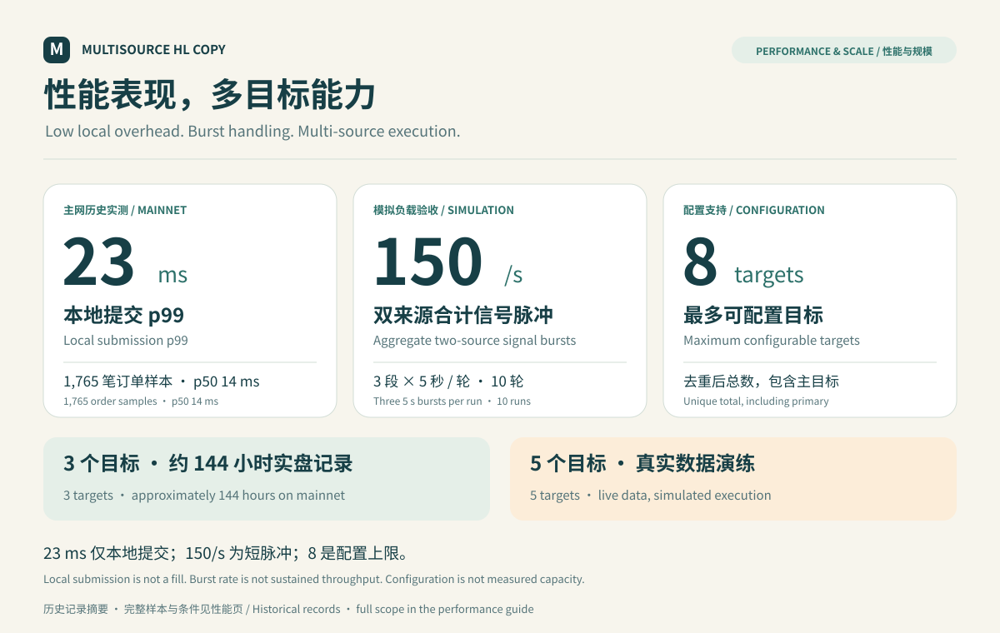

# Performance and scale

[中文](../performance.md) · [Home](../../README.en.md) · [Results data](../../benchmarks/results.json) · [Methodology](../../benchmarks/README.md)

**43 ms local-submission p99 · 150 signals/s burst test · up to 8 configurable targets**

These figures come from retained project records of historical mainnet observations, simulated load, and configuration validation. Results and necessary conditions are public; implementation, real source identities, deployment identifiers, and raw events remain private. The measurement period is November 2026. Each result belongs to its recorded build; this documentation update did not rerun production benchmarks.

## Results at a glance

| Metric | Result | Scope |
| --- | --- | --- |
| Local submission latency | **p50 24 ms · p90 30 ms · p99 43 ms** | 1,765 mainnet order samples; local receipt to recorded submission |
| Two-source burst handling | **150 new-order signals/s aggregate** | 75/s per source; three 5-second bursts per run; 5-second gaps; 10 simulated runs |
| Tail latency in that burst test | **Per-run p99: 139–186 ms** | Simulated signal broadcast to receipt of the corresponding order request |
| Request matching in that scenario | **100% matched · 0 simulated 429 responses** | Distinct instruments across two sources; injected orders matched to first corresponding requests |
| Configurable targets | **Up to 8** | Total unique normalized targets in one configuration, including the primary |
| Recorded multi-target live session | **3 targets · about 80 minutes** | Historical small-account mainnet summary |
| Recorded multi-target rehearsal | **5 targets · about 5 minutes** | Live source data with simulated follower-side execution |

Each result has a separate record in [results.json](../../benchmarks/results.json). Eight is a configuration ceiling; three and five are recorded scales under different validation modes.

## 1. Low local submission latency

Across 1,765 mainnet order samples, local submission latency had a **24 ms median**, **43 ms p99**, and **151 ms observed maximum**.

The measured interval is:

> Signal receipt on the local host → recorded order-submission timestamp.

It describes local processing overhead. It does not verify that bytes have left the network socket, and excludes upstream delivery, exchange acknowledgement, and fills. Selected rows required an exchange-side order identifier, a qualifying session, and both timestamps. Skipped or unsubmitted signals are not included.

This result demonstrates low local overhead on the observed submission path. It is not an end-to-end fill latency or a guarantee for every incoming signal.

### Separate local processing from external stages

| Stage | Samples | p50 | p90 | p99 |
| --- | ---: | ---: | ---: | ---: |
| Source order in block → follower signal receipt | 3,734 | 203 ms | 277 ms | 312 ms |
| Follower signal receipt → recorded submission | 1,765 | 24 ms | 30 ms | 43 ms |
| Recorded submission → follower order in block | 1,765 | 576 ms | 791 ms | 1,327 ms |
| Source-triggered follower cancellation request → cancellation in block | 1,509 | 498 ms | 564 ms | 650 ms |

The stages do not all use the same sample set. Signal-delivery samples can include signals that did not produce a follower order; cancellation samples cover only source-triggered follower cancellations. **Adding their p99 values does not yield an end-to-end p99.** Joint per-event samples are not distributed, and inclusion of an order in a block is not proof of a fill.

## 2. Burst-oriented signal processing

The two-source simulation used **150 offered new-order signals/s in total**: 75/s per source, three 5-second bursts per run, 5-second gaps, and ten seeded runs.

The retained results show:

- Every injected source order matched its first corresponding order request.
- No simulated 429 responses occurred in that scenario.
- The ten per-run p99 values ranged from **139 to 186 ms**.

Matching means that the simulator received a request, not that a real trade filled. Timing begins at simulated signal broadcast after the modeled push delay and ends when the simulator receives the request.

**The passed workload is a short-burst test.** It establishes neither complete sustained dispatch at 150/s nor maximum throughput. Other longer-window workloads under different settings had incomplete dispatch. An exploratory 300/s load encountered order-cap rejections and longer tail latency and is excluded from the passed-capacity claim.

## 3. Multi-target scale: configuration and validation

| Level | Targets | What it establishes |
| --- | ---: | --- |
| Configuration support | **8** | Up to eight unique targets can be set in one configuration |
| Live-data rehearsal | **5** | A recorded five-target rehearsal lasting about five minutes |
| Mainnet execution | **3** | A recorded three-target session lasting about eighty minutes |
| Two-source load acceptance | **2** | A recorded aggregate 150/s simulated burst test |

The rehearsal does not establish five simultaneously saturated sources, and eight configurable targets is not a measured full-load live capacity. The different layers provide evidence for multi-source operation without collapsing support and measured capacity into one number.

## 4. End-to-end mainnet observations

A separate small-account mainnet test with a script-controlled source retained these medians from a roughly five-minute round:

| Path | Samples | p50 |
| --- | ---: | ---: |
| Source order effective → follower order effective | 73 | **809 ms, about 0.81 s** |
| Source cancellation effective → follower cancellation effective | 69 | **666 ms, about 0.67 s** |

Both endpoints use exchange timestamps. These are different intervals and samples from the 43 ms local metric. No end-to-end p99 was retained, so it is not inferred from the medians.

## Engineering strengths behind the presentation

- **Event-driven Rust execution:** separates real-time execution from Python control and reporting responsibilities.
- **Multiple-source operation:** configuration support, recorded operation, and simulated load each have their own evidence.
- **Burst testing:** repeated bursts report request matching and tail latency rather than an average alone.
- **An operational workflow:** order following, position changes, risk intervention, and reporting form the product experience; see [Capabilities](features.md).

These results describe engineering capability, not guaranteed fills, returns, or identical performance in every environment.

## Measurements still to add

Sustained full-load throughput, eight simultaneously active live targets, hardware-class comparisons, peak backlog, and current-build end-to-end p95/p99 need separate measurements. Missing results are not filled with illustrative numbers.

The historical records do not retain a complete public hardware and system-load description or raw per-event samples. They describe this project's recorded results, not a hardware-controlled comparison with other products. See [Verification and evidence](testing.md) and [Public scope](public-scope.md).
