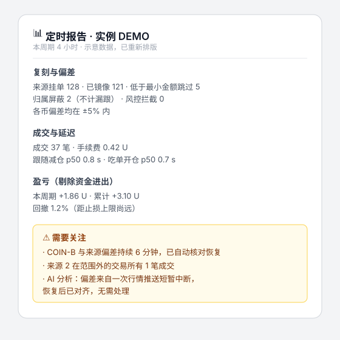

# Scenario guide

[中文](../showcase.md) · [Project home](../../README.en.md) · [Features](features.md) · [FAQ](faq.md)

Four reading journeys illustrate the information the product aims to make understandable: source activity, order lifecycles, risk states, and reports. **Every scenario is SIMULATED / 合成示例.** Relationships, sources, assets, states, and values are entirely fictional. They are not real accounts, trading records, or test results.

The illustrations were made for public explanation and are not production screenshots. This page has no interactive functionality that connects to markets, executes orders, or produces live reports. It cannot establish whether capabilities are implemented, deployed, or live-verified.

## Where to start

| Question | Suggested reading |
|---|---|
| How is a source action explained in the materials? | Journey one and the synthetic scenario data |
| Can readers retain context across several sources? | Journey two |
| How does risk information distinguish an action from an unresolved outcome? | Journey three and the synthetic event data |
| How can someone quickly understand a period of activity? | Journey four and the synthetic report data |

See [Features](features.md) for capabilities and limitations, and [Verification scope](testing.md) for the boundaries of public evidence.

## Fictional setting

This page uses an entirely fictional context:

| Identifier | Meaning within the examples only |
|---|---|
| SOURCE_A | One fictional thread of source activity |
| SOURCE_B | Another fictional thread of source activity |
| ASSET_X | A fictional asset label used to discuss orders and states |
| ASSET_Y | A fictional label used to distinguish another asset context |

These identifiers cannot connect accounts, identify real wallets, or configure trading. Any example values serve presentation and readability only. They are not market prices, account balances, returns, or measurements.

## Journey one: understand an order lifecycle

**Situation:** SOURCE_A expresses a trading intent involving ASSET_X. That intent later changes, and related records move into another state. A reader wants to understand how the pieces of information relate.

| Reading order | What the example conveys | What a reader can assess |
|---|---|---|
| Source context | Who has activity involving which fictional asset | Whether source and asset labels are clear |
| Response description | How a related response is described | Whether the source action and the response are kept distinct |
| State change | How earlier and later records relate | Whether state terminology is understandable |
| Outcome summary | What is currently known and what remains uncertain | Whether unresolved information is incorrectly presented as complete |

This journey explains information relationships, not an internal scheduling sequence. Connections in the illustration do not mean that a source fill guarantees a follower fill or identical quantities, prices, and outcomes.

**Companion material:** [examples/scenario.json](../../examples/scenario.json). This is a static synthetic situation, not trading input, a configuration file, or a real event record.

## Journey two: retain context across multiple sources

**Situation:** SOURCE_A and SOURCE_B appear in an activity summary involving ASSET_X and ASSET_Y. A reviewer needs to identify which source, asset, and state each record concerns.

| Reading focus | Useful question |
|---|---|
| Source identity | Does the summary retain the source label outside the detailed scenario? |
| Asset context | Are different records involving the same asset label easy to distinguish? |
| State differences | Can the reader distinguish source activity, a response description, and an outcome statement? |
| Attention items | Can a notice be related back to the relevant scenario? |

Sources are displayed together only to explain the reading experience. This does not disclose capital allocation, trading ownership, execution priority, or which orders should ultimately result for an asset.

**Companion material:** [Features: multiple-source organization](features.md#1-multiple-source-organization) and the [synthetic report data](../../examples/report.json).

## Journey three: read a risk notice and its outcome

**Situation:** a fictional notice concerning ASSET_X appears in an activity record. A reader wants to understand what happened, what action was recorded, and what remains unconfirmed.

Keep three questions distinct:

| Question | Information the public example focuses on |
|---|---|
| What deserves attention? | A brief event description and its context |
| What intervention was recorded? | An understandable action or state description |
| Is the outcome clear? | Known results, open questions, and notes for human review |

Terms such as pausing new activity, cancelling orders, or addressing positions explain possible visible outcomes. This page does not prescribe which real event must lead to which action or the order in which actions occur.

**Companion material:** [examples/risk-event.json](../../examples/risk-event.json). Its events and outcomes are synthetic, not importable risk rules. Showing an action in an example does not establish that it would complete promptly or achieve its intended result in a real market.

## Journey four: read an activity report

**Situation:** instead of reading every activity record, someone starts with a summary and then decides which items deserve closer examination.

| Report content | Reading purpose |
|---|---|
| Sources and activity overview | Establish the contexts covered by the summary |
| States and differences | Find changes or inconsistencies that need explanation |
| Attention items | Identify information worth examining further |
| Related notes | Understand the distinction between known facts and explanatory text |

A report should not make “information not provided” look like “no problem,” or present explanatory text as a verified root cause. The illustration lets readers assess whether those distinctions are clear.

**Companion material:** [examples/report.json](../../examples/report.json). All summary content is fictional. It cannot establish actual following quality, latency, returns, or risk levels. This repository does not generate the report periodically.

## How to review this showcase

After reading, visitors can raise specific questions suitable for public discussion:

- Are source and asset labels used consistently?
- Does a description refer to a source action, a response, or an outcome?
- Is unresolved information clearly identified?
- Do risk notices and attention items point readers toward the relevant explanation?
- Do illustrations, prose, and synthetic data describe a consistent situation?
- Do Chinese and English retain the same limitations?

These questions assess the clarity and completeness of public materials, not the private trading program.

## Common misreadings and limitations

| Possible misreading | What this page actually establishes |
|---|---|
| A flow illustration proves that every step succeeds in a market | It only explains how a fictional process is described |
| A multiple-source illustration discloses the execution strategy | It only shows how reading context can be retained across sources |
| A risk-event example promises to limit real losses | It only distinguishes a notice, an action, and an outcome |
| A report is a live statistic or performance sample | It is a presentation made from synthetic content |
| JSON can be used directly as account configuration | The files are for reading, not production interfaces or configuration contracts |
| Showing a state proves that a feature is live | Illustrations are not implementation, deployment, or verification evidence |

The public package provides no reproducible production experiment, real-market test, independent audit, or benchmark measurement. Assessing real execution quality requires separate evidence tied to a specific version and environment. These synthetic materials cannot replace it.

## Giving feedback

Useful feedback can be concrete: “In journey three, the action description and the outcome description are easy to confuse; please label them separately.” Reference the page or example location and describe the situation with fictional identifiers such as SOURCE_A and ASSET_X.

Related reading: [Features](features.md) · [Public scope](../../PUBLIC_SCOPE.md) · [Verification scope](testing.md) · [Public showcase roadmap](roadmap.md).
