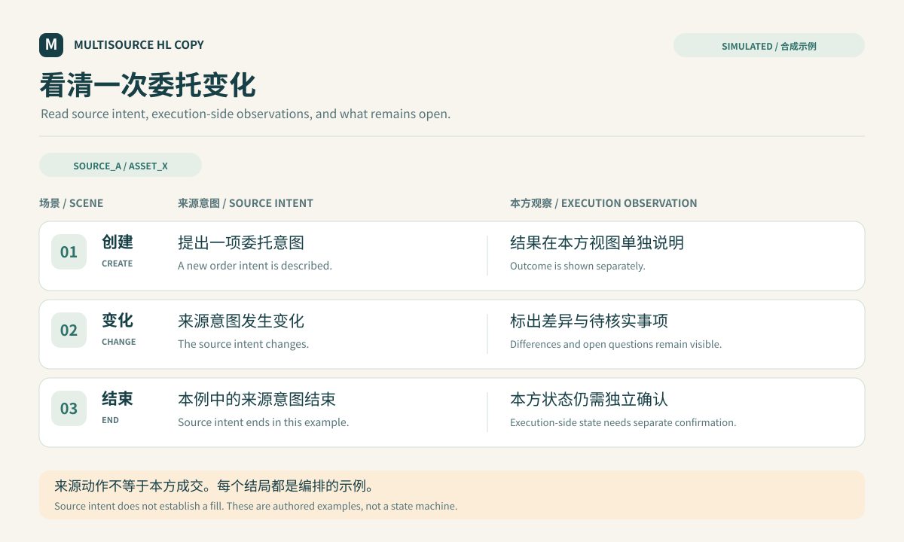
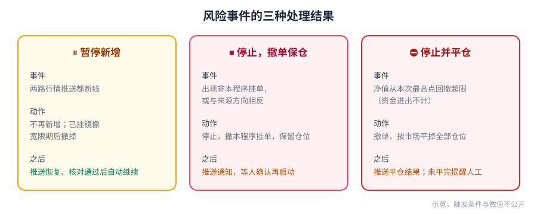

# Showcase

Three representative scenarios plus the results of one limited live test. See [Testing & methodology](testing.md) for how numbers are reported.

Images marked "illustrative data" are reconstructed: accounts, amounts, times and coins are not real records.

## Scenario 1: normal following

The source places a limit buy; the system places a proportional mirror. The source changes the price; the mirror is amended in place. The source order fills; so does the mirror, and the own position stays proportional to the source. The source then reduces by half; the own side follows with a reduce-only order for half.

**What you can observe:** every step has a matching own order, final state matches the exchange, and no orphan orders remain.

## Scenario 2: risk events

| Event | Action | Afterwards |
|---|---|---|
| Both data feeds disconnected | Pause new orders; resting mirrors are cancelled after a grace period | Resumes automatically once feeds recover and reconciliation passes |
| Foreign orders appear, or own side opposes the source | Stop, cancel this program's orders, **keep positions** | Restart after human confirmation |
| Equity drawdown from the run's peak exceeds the limit | Stop and **flatten** | Result is notified; any unflattened remainder is escalated |

Trigger values and decision details are private.

## Scenario 3: reports and investigation

The periodic report condenses one period onto a single screen. The final "attention" section lists what deserves a human look, e.g. a coin deviating from the source for several minutes, source positions on out-of-scope venues, or large source transfers. The server-side AI assistant adds an anomaly analysis. For deeper investigation the rolling incident trace of that run can be retrieved.

## Limited live test: mainnet shadow test (2026-11-16)

**Setup:** a scripted test wallet acts as the source and places preset scenarios; the follower runs live on mainnet with a small account, mirroring at equal size, each order close to the exchange minimum; two rounds of about 5 minutes each.

**Scenario results:**

| Scenario | Round 1 | Round 2 |
|---|---|---|
| Far-from-market orders (3, cancelled after 20 s) | Pass 3/3 | Pass 3/3 |
| Rapid cancels (10, cancelled within 0.5–2 s) | Pass 10/10 | Pass 10/10 |
| 3 price amends + 1 size amend | Pass | Pass |
| 50 orders placed within 1 s | Inconclusive: 45 blocked by an account position cap set too low | **Pass 50/50** |
| 5-level ladder | Pass 5/5 | Pass 5/5 |
| Rest until filled, then follow the close | Pass | Inconclusive: the script's source order was rejected by the exchange |
| Taker open | Pass | Pass |
| Halve then close | Pass | Pass |
| Out-of-scope venue orders not followed | Pass | Pass |
| Overall: no leftover orders, follower flat, state consistent | Pass | Pass |

**Latency** (median over 73 orders in round 2, exchange timestamps):

| | Place | Cancel |
|---|---|---|
| End to end: source effective → mirror effective | ~0.81 s | ~0.67 s |
| Of which this system: push received → decision | ~0.2 s | ~0.2 s |
| Sent → accepted by exchange | ~0.57 s | ~0.46 s |

The two segments use the server and exchange clocks respectively, so they do not add up exactly to end to end; the end-to-end row uses exchange timestamps only.

**What it shows:** the main following paths work as designed on the real exchange; most of the end-to-end latency is exchange confirmation.

**Not covered:** single source at equal size, orders near the minimum (no case of falling below it after scaling); a few minutes per round, at most 50 simultaneous orders — no sustained high frequency, reconnects or violent markets; no partial fills, multi-level sweeps, illiquid coins or position flips; following quality only, not PnL deviation from the source. The version tested is older than the current one and these results have not been re-run on it.
