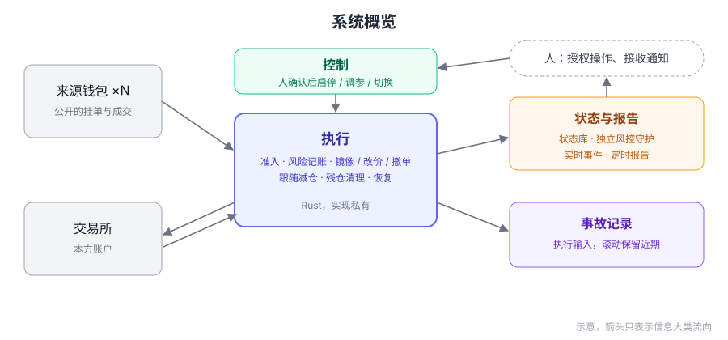

# 系统概览

系统由四部分组成。箭头只表示信息大致的流向，不代表真实的协议或调度顺序。

| 部分 | 职责 | 实现 |
|---|---|---|
| **控制** | 本地操作入口：生成启动清单，经人确认后启动、停止、调参、切换来源、部署。敏感操作必须有明确授权，否则直接拒绝 | Python；授权与命令细节不公开 |
| **执行** | 接收来源与本方的事件，做准入、风险记账、下单、改价、撤单、跟随减仓、残仓清理和恢复。热路径不经过 Python | Rust 执行引擎，**私有** |
| **状态与报告** | 状态库保证每个来源订单只处理一次；守护进程独立核对风险；推送实时事件和定时报告 | Python 与 Rust |
| **事故记录** | 记录执行核心的全部输入，滚动保留近期内容，供事后排查 | Rust，后台写入 |

## 部署形态

- 每台服务器独立运行一个或多个实例。每个实例有自己的账户、来源、状态库和密钥，实例之间互不影响。
- 没有管理面板，人通过本地命令行助手操作，通过即时消息接收通知。
- 只连主网。演练（dry_run）时本方使用本地账本，来源仍读主网。
- 服务器上可以同时保留多个代码版本。运行中的实例固定在启动时的版本上，部署新版本不会打断正在运行的交易。

## 三个设计原则

1. **不重复。** 每个来源订单只认领一次；结果不明的委托不重发。
2. **证据不足就停。** 数据不完整、对不上账、范围不确定时，宁可暂停，也不按猜测下单。
3. **人做最终决定。** 启动、停止、平仓、部署、改配置都要人明确授权。程序自己能做的只有风控停止。

示意代码见 [outline/](../outline/)。它们只说明各部分的职责，不是生产实现。
