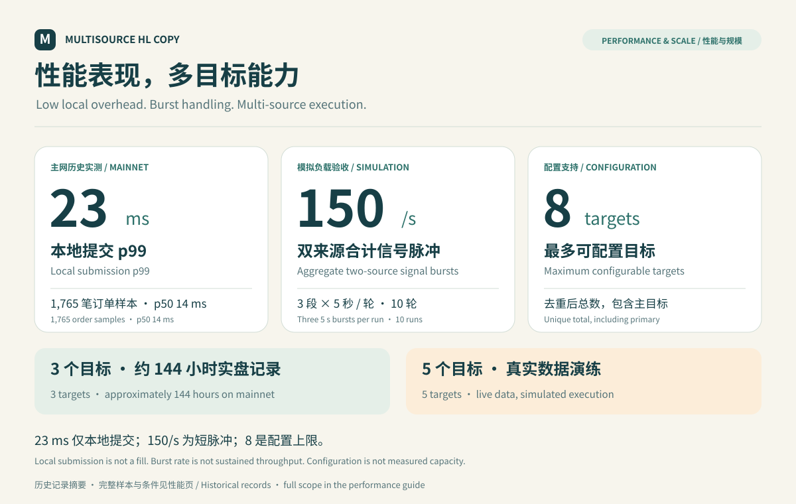

# 性能与规模

[English](en/performance.md) · [项目首页](../README.md) · [测量数据](../benchmarks/results.json) · [口径说明](../benchmarks/README.md)

**43 ms 本地提交 p99 · 150 条信号/秒脉冲测试 · 最多 8 个可配置目标**

这些数字来自项目保留的历史实盘、模拟负载与配置校验记录。公开结果和必要条件，不公开实现、真实来源、部署标识或原始事件。测量期为 2026 年 11 月；不同条目对应各自的记录版本，本次文档更新没有重新运行生产基准。

## 核心结果

| 指标 | 公开结果 | 测试或证据范围 |
| --- | --- | --- |
| 本地提交延迟 | **p50 24 ms · p90 30 ms · p99 43 ms** | 1,765 笔主网订单样本；本机收到信号至记录提交时点 |
| 双来源脉冲承载 | **合计 150 条新委托信号/秒** | 每来源 75/s；每轮 3 段 × 5 秒；段间 5 秒；10 轮模拟测试 |
| 同一脉冲测试的尾延迟 | **各轮 p99 为 139–186 ms** | 模拟信号广播至模拟交易所收到对应订单请求 |
| 该场景的请求匹配 | **100% 匹配 · 模拟 429 为 0** | 两来源使用不同资产；注入信号与首笔对应请求匹配 |
| 可配置目标数 | **最多 8 个** | 单配置内去重后总数，包含主目标 |
| 已记录的多目标实盘 | **3 个目标 · 约 80 分钟** | 历史同会话主网小额运行摘要 |
| 已记录的多目标演练 | **5 个目标 · 约 5 分钟** | 真实来源数据，本方执行使用模拟账本 |

每条指标都可在 [results.json](../benchmarks/results.json) 找到独立记录。8 是配置上限，3 和 5 是不同验证方式下实际记录的规模。

## 1. 低本地提交延迟

在 1,765 笔主网订单样本中，本地提交延迟的中位数是 **24 ms**，p99 是 **43 ms**，最大观测值是 **151 ms**。

这里测量的是：

> 信号到达本机 → 记录订单提交时点。

这一时间点用于描述本地处理开销，不证明网络字节已经离开套接字，也不包含来源传播、交易所确认或成交等待。样本要求订单有交易所订单标识、属于选定会话且具备所需时间戳，因此不覆盖所有输入信号、跳过或未提交的请求。

这项结果展示的是已提交订单路径的低本地开销。它不被改写成“43 ms 端到端成交”或所有信号的时延保证。

### 把本地与外部环节分别呈现

| 环节 | 有效样本 | p50 | p90 | p99 |
| --- | ---: | ---: | ---: | ---: |
| 来源订单入块 → 本方收到信号 | 3,734 | 203 ms | 277 ms | 312 ms |
| 本方收到信号 → 记录提交时点 | 1,765 | 24 ms | 30 ms | 43 ms |
| 记录提交时点 → 本方订单入块 | 1,765 | 576 ms | 791 ms | 1,327 ms |
| 跟随来源撤单：本方请求 → 撤单入块 | 1,509 | 498 ms | 564 ms | 650 ms |

不同环节的样本集合不完全相同。信号传播样本可包含最终没有形成本方订单的信号；撤单样本只覆盖由来源撤单触发的本方撤单。**不能把这些 p99 相加得到端到端 p99**；原始逐笔联合样本未随公开包发布。订单入块也不等于订单成交。

## 2. 面向突发的信号处理

双来源模拟验收以 **150 条新委托信号/秒的合计输入速率**运行：每个来源 75/s，每轮三段 5 秒脉冲，段间隔 5 秒，共 10 个种子轮次。

已记录结果：

- 每轮注入的来源委托都匹配到了对应的首笔订单请求。
- 该模拟场景没有出现 429 响应。
- 每轮 p99 的范围为 **139–186 ms**。

这里的“匹配到请求”说明请求到达了模拟交易所，不表示实盘成交率为 100%。该延迟从模拟信号广播开始，排除了之前建模的推送延迟，终点是模拟端收到请求。

**已验证的是短脉冲负载。** 当前记录未建立持续 150/s 的满量派发能力或最大吞吐上限；其他更长窗口、不同负载设置下存在未全量派发记录。更高的 300/s 探索性负载出现了委托容量拒绝和更长尾延迟，不列入通过能力。这样保留了测试结果的说服力，也给出了可用边界。

## 3. 多目标规模：配置与验证分开看

| 层次 | 数量 | 可以说明什么 |
| --- | ---: | --- |
| 配置支持 | **8** | 可以在同一配置中设置最多 8 个去重后的目标 |
| 真实数据演练 | **5** | 记录过 5 目标、约 5 分钟的真实数据演练 |
| 主网实盘 | **3** | 记录过 3 目标、约 80 分钟的同会话主网运行 |
| 双来源负载验收 | **2** | 记录过双来源合计 150/s 的模拟脉冲测试 |

5 目标演练不等于 5 个目标同时满载发单；8 个目标也尚未被这里的数据证明为高负载实盘上限。以上结果共同说明多来源能力已有不同层次的验证，不用一个数字混合配置能力和实测容量。

## 4. 端到端主网观察

另一次脚本控制来源的主网小额测试，保留了单轮约 5 分钟的端到端中位数：

| 路径 | 样本 | p50 |
| --- | ---: | ---: |
| 来源委托生效 → 本方委托生效 | 73 | **809 ms，约 0.81 秒** |
| 来源撤单生效 → 本方撤单生效 | 69 | **666 ms，约 0.67 秒** |

这两项使用交易所两端时间戳。它们与前面的 43 ms 本地指标属于不同范围、不同样本。该记录未保留端到端 p99，因此不从中位数推算 p99。

## 工程优势与数字的关系

- **Rust 事件驱动执行核心：** 将实时执行与 Python 控制、报告职责分开，关注本地处理开销。
- **多来源执行：** 配置支持和真实运行、模拟负载分别给出证据。
- **突发负载验证：** 通过重复短脉冲观察请求匹配和尾延迟，而不只报告平均值。
- **完整运行体验：** 委托跟随、仓位变化、风险干预和报告共同组成使用链路，见 [功能说明](features.md)。

这些结果体现工程能力，不承诺成交、收益或所有环境下的相同性能。

## 还需要补充哪些测量

持续满载吞吐、8 目标同时活跃的实盘容量、不同硬件等级、突发积压峰值，以及当前版本的端到端 p95/p99，应以单独的测量补齐。未测项目不使用示意数字填补。

历史记录未完整保留可公开的硬件、系统负载与环境描述，也未附原始逐笔数据。当前展示适合了解项目自身的已记录结果，不适合据此作跨产品硬件公平对比。更新规则见 [验证与证据](testing.md) 和 [公开范围](../PUBLIC_SCOPE.md)。
