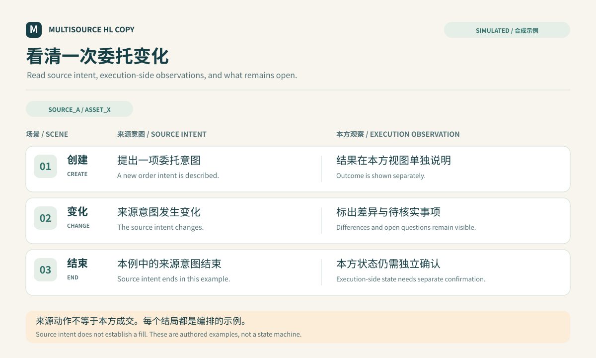
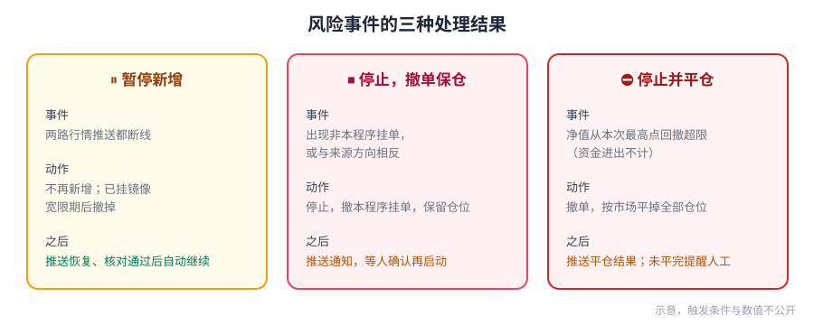
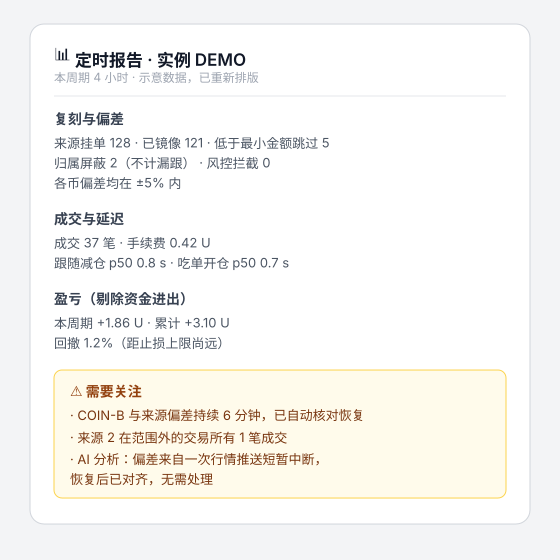

# 场景导览

[English](en/showcase.md) · [项目首页](../README.md) · [功能说明](features.md) · [常见问题](faq.md)

本页以四条阅读旅程展示产品希望让使用者理解的信息：来源活动、委托过程、风险状态与报告。**所有场景均为 SIMULATED / 合成示例。** 人物关系、来源、资产、状态和数值全部虚构，不代表真实账户、交易记录或测试结果。

示意图是为公开介绍制作的说明画面，不是生产截图。本页没有连接市场、执行订单或生成实时报告的交互功能。能力是否已实现、部署或经过实盘验证，不能从这些材料中得出。

## 从哪里开始

| 想了解的问题 | 建议阅读 |
|---|---|
| 一条来源动作如何在材料中被解释？ | 旅程一与合成场景数据 |
| 多个来源是否仍能分清上下文？ | 旅程二 |
| 风险信息怎样表达动作与未决结果？ | 旅程三与合成事件数据 |
| 如何快速读懂一段活动？ | 旅程四与合成报告数据 |

完整的能力与限制见 [功能说明](features.md)；公开证据的边界见 [验证范围](testing.md)。

## 场景设定

本页使用一套完全虚构的上下文：

| 标识 | 仅在示例中表示 |
|---|---|
| SOURCE_A | 一条虚构的来源活动线索 |
| SOURCE_B | 另一条虚构的来源活动线索 |
| ASSET_X | 用来讨论委托与状态的虚构资产标签 |
| ASSET_Y | 用来区分另一类资产上下文的虚构标签 |

这些标识不能用于连接账户、查询真实钱包或配置交易。如果示例中出现数值，它们只服务于排版与阅读，不代表行情、账户余额、收益或测量结果。

## 旅程一：读懂一次委托过程

**情境：** SOURCE_A 对 ASSET_X 表达一项交易意图，之后意图发生变化，相关记录最终进入另一种状态。读者希望从几条信息中看懂它们的关系。

| 阅读顺序 | 示例要表达什么 | 读者可以检查什么 |
|---|---|---|
| 来源情境 | 谁对哪个虚构资产产生了活动 | 来源与资产标签是否明确 |
| 响应描述 | 与该活动相关的响应被如何表述 | 是否把来源动作和响应分开 |
| 状态变化 | 前后记录如何联系 | 状态词是否容易理解 |
| 结果摘要 | 当前已知的结果与仍未确定的内容 | 是否避免把未决信息写成完成 |

这一旅程说明的是信息关系，不规定内部调度顺序。图中的关联也不意味着来源成交后本方必然成交，或两边的数量、价格与结果必然一致。

**配套材料：** [examples/scenario.json](../examples/scenario.json)。这是静态合成情境，不是交易输入、配置文件或真实事件记录。

## 旅程二：在多个来源之间保持清楚的上下文

**情境：** SOURCE_A 与 SOURCE_B 都出现在一份活动摘要中，摘要涉及 ASSET_X 和 ASSET_Y。评审者需要判断某条记录在说哪个来源、哪个资产，以及什么状态。

| 阅读关注点 | 有用的问题 |
|---|---|
| 来源身份 | 离开详细场景后，摘要还保留来源标签吗？ |
| 资产上下文 | 相同资产标签下的不同记录是否容易分辨？ |
| 状态差异 | 是否可以区分来源活动、响应描述与结果说明？ |
| 关注事项 | 一条提示能否关联回需要阅读的场景？ |

多个来源被放在一起展示，只为了说明阅读体验。不能从中推导资金分配、交易归属、执行优先级，或同一资产最终应产生怎样的委托。

**配套材料：** [功能说明：多来源组织](features.md#1-多来源组织)与[合成报告数据](../examples/report.json)。

## 旅程三：阅读风险提示与处置结果

**情境：** 与 ASSET_X 有关的一条虚构提示出现在活动记录里。读者希望了解发生了什么、记录了什么动作，以及还有什么不能确认。

阅读时应区分三个问题：

| 问题 | 公开示例关注的信息 |
|---|---|
| 什么值得关注？ | 事件的简要描述及相关上下文 |
| 记录了什么处置？ | 可读的动作或状态说明 |
| 结果是否明确？ | 已知结果、待确认事项和人工阅读提示 |

暂停新增活动、撤销委托或处置持仓等词语，只用于解释可能的可见结果。本页不规定哪一类真实事件必然触发哪一种动作，也不说明这些动作的顺序。

**配套材料：** [examples/risk-event.json](../examples/risk-event.json)。其中的事件和结果均为合成内容，不是可导入的风控规则。一个示例显示某项动作，也不能证明真实市场中该动作会及时完成或达到预期效果。

## 旅程四：阅读一份活动报告

**情境：** 读者不逐条浏览活动记录，而是先看摘要，再决定哪些内容值得进一步查看。

| 报告内容 | 阅读目的 |
|---|---|
| 来源与活动概览 | 建立这份摘要涉及哪些情境的整体印象 |
| 状态与差异 | 找到需要解释的变化或不一致 |
| 关注事项 | 明确哪些信息值得继续阅读 |
| 相关说明 | 理解已知事实与解释性文字之间的界限 |

报告不应让“未提供信息”看起来像“没有问题”，也不应把解释性文字当作已经核实的根因。本仓库的报告示意用来评估这种表达是否清楚。

**配套材料：** [examples/report.json](../examples/report.json)。所有汇总内容均为虚构，不能用于推断真实跟随率、延迟、收益或风险水平。本仓库不会周期性生成这份报告。

## 如何评审这份展示

读完后，访问者可以提出具体、可公开讨论的问题：

- 同一个来源或资产的标签是否前后一致？
- 某条文字描述是在说来源动作、响应还是结果？
- 示例有没有清楚标出未决信息？
- 风险提示和关注事项能否让读者知道接下来该看哪段说明？
- 图片、文字与合成数据是否表达同一种情境？
- 中文与英文是否保留了相同的限制条件？

这些问题评审的是公开材料的清晰度和完整性，不是在检验私有交易程序。

## 常见误读与限制

| 可能的误读 | 本页实际能说明的内容 |
|---|---|
| 流程图证明每一步都能在市场上成功 | 只说明如何讲解一次虚构过程 |
| 多来源示意公开了执行策略 | 只说明如何保留多个来源的阅读上下文 |
| 风险事件示例承诺控制真实损失 | 只说明如何区分提示、动作与结果 |
| 报告是实盘统计或性能样本 | 它是由合成内容制作的展示画面 |
| JSON 可以直接用于账户配置 | 它们只供阅读，不是生产接口或配置契约 |
| 图中出现某种状态就说明功能已上线 | 图示不构成实现、部署或验证证据 |

公开包不提供可重现的生产实验、真实市场测试、独立审计或基准测量。对真实执行质量的判断，需要与明确版本和环境相对应的另外证据；这里的合成材料不能代替它们。

## 提出反馈

有用的反馈可以很具体，例如：“旅程三里，动作说明与结果说明容易混淆，建议分别标注。”请引用页面或示例位置，并使用 SOURCE_A、ASSET_X 这样的虚构标识描述情境。

相关入口：[功能说明](features.md) · [公开范围](../PUBLIC_SCOPE.md) · [验证范围](testing.md) · [公开展示路线图](roadmap.md)。
